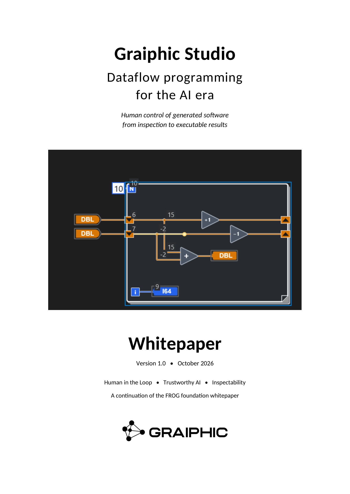
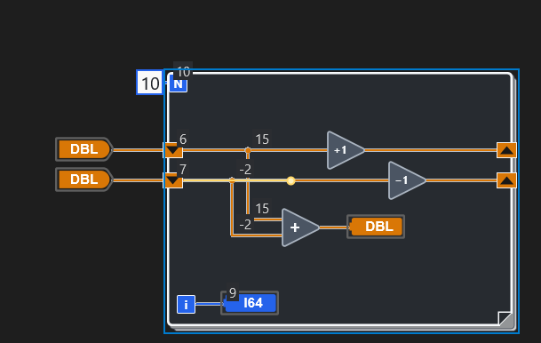
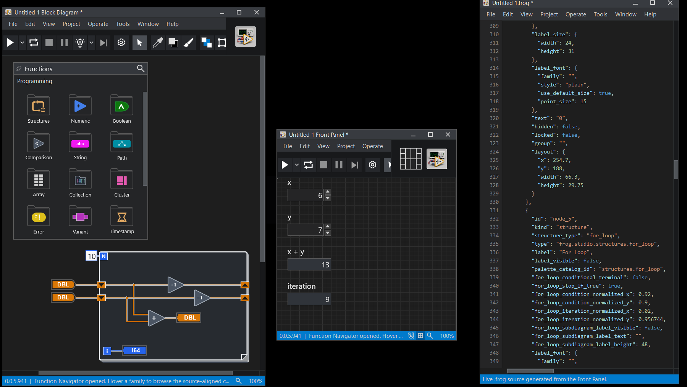
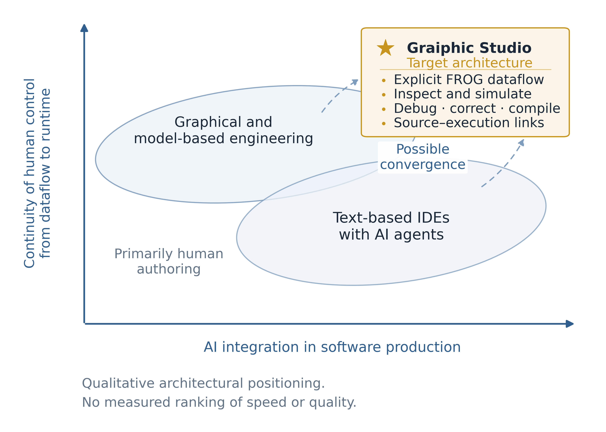

  

  

<h1 align="center">Graiphic Studio</h1>

  <strong>Dataflow programming for the AI era</strong> 
  Human control of generated software from inspection to executable results 
  Whitepaper 1.0 · October 2026

  <a href="./Graiphic_Studio_Whitepaper_1.0.pdf">Download the PDF</a> ·
  <a href="./Heilmeier.md">Heilmeier framing</a> ·
  <a href="../FROG%20-%20Opening%20the%20Next%20Era%20of%20Graphical/Readme.md">FROG foundation whitepaper</a> ·
  <a href="../README.md">GO Whitepaper Series</a>

## Overview

As coding agents contribute more implementation, the ability to understand, validate and change the result becomes an industrial capability. Graiphic Studio is being developed around that shift. Graphical programming gives engineers a way to inspect consequential behaviour, examine execution and carry a correction into a subsequent build.

This whitepaper continues the FROG foundation paper. FROG provides an open graphical dataflow language foundation; Graiphic Studio is Graiphic's proprietary solution built around it. The central thesis is that faster software generation creates a growing need for effective human control. The intended result is a shorter path from a generated proposal to an understood, accepted and deployable system.

## Dataflow as an inspection language

A dataflow graph makes dependencies visible through operations, connections and structures. It helps an engineer ask which values enable an operation, where state changes, and how an external action relates to the rest of the program. Hierarchy and focused views are essential as programs grow: a useful abstraction should reveal important behaviour while retaining a dependable connection to its implementation.

Runtime highlighting and value annotations connect that structure to observations from execution. Probes and breakpoints provide focused ways to investigate a result. The development screenshot below shows numeric values and a highlighted wire marker within a loop.

  

Controlled scenarios and simulated interfaces are part of the product direction. They should help engineers exercise selected conditions, reproduce faults and verify corrections. Their usefulness depends on explicit models and coverage; hardware timing and physical behaviour still require validation on the relevant target.

## Three routes into one engineering workflow

- **Graphical authoring:** an engineer places operations, connects data and edits the program directly.
- **Agent generation:** an agent produces the structured `.frog` representation for validation and graphical review.
- **Supported language imports:** a bridge brings existing software into the workflow within a defined semantic and build context.

Import coverage must be stated. An inspection view and an editable executable translation have different requirements, particularly for memory, concurrency, external libraries and target assumptions. The ambition is to expand supported bridges while preserving the relationship between the program under review and the code that executes.

  

The development workspace above brings graphical logic, the front panel and textual FROG source together. Both screenshots are original Graiphic Studio captures. Their application build number is separate from this whitepaper's edition number.

## Human in the Loop and Trustworthy AI

Human participation needs understanding and the ability to act. The proposed workflow lets an engineer inspect a proposal, examine evidence, request or make a correction, and accept an identified version. Build inputs, dependencies and runtime observations must remain connected to that decision.

Trustworthy AI is an engineering objective in this context. Graphical inspection can help reveal a suspicious effect or unnecessary operation; dependable acceptance also requires analysis, tests and evidence for the application. The whitepaper explains how this combination can support human responsibility without treating a readable graph as a guarantee of correctness.

## Industrial relevance and economic potential

The architecture is general purpose. Instrumentation, acquisition and test benches provide an initial field where software behaviour has measurable consequences. NI, Beckhoff, Keysight, ADLINK, UEI, Gantner and Rohde & Schwarz illustrate the varied ecosystem that supported adapters could serve.

Native libraries, documented APIs and instrument protocols provide integration routes. Compatibility still depends on device models, drivers, types, timing and operating conditions. LLVM is the first compiler bridge and proof of feasibility; further compiler routes form part of the roadmap.

Expected gains include shorter fault investigations, less repeated integration work, earlier commissioning and easier transfer of engineering knowledge. Industrial pilots should measure complete tasks, including review, correction, training, migration and maintenance. Engineering capacity released and cash expenditure avoided are distinct economic outcomes.

## The technological moat

Graiphic's proposed moat is the continuity of human control from generated logic to executable results. It accumulates through semantic fidelity, usable inspection, actionable correction and maintained integrations. The research programme addresses preservation of meaning, abstraction at scale, mappings to optimised execution, simulation boundaries and improved human judgment.

  

The Orville chart is a qualitative positioning framework. Graiphic Studio marks a target architecture, not a measured competitive ranking or a claim of universal exclusivity. Appendix B of the PDF explains its scope. The whitepaper also examines LabVIEW's graphical inheritance and the pressure that coding agents place on accessibility as a differentiator; Graiphic's case depends on its own demonstrated results.

## An open foundation and a commercial solution

FROG remains the open language foundation. Graiphic Studio will be distributed under a commercial licence. A planned marketplace would let third parties provide toolkits, hardware adapters and compiler bridges with clear compatibility and maintenance contracts. Pricing, publisher terms and product guarantees will be defined for their supported scope.

The [Heilmeier framing](./Heilmeier.md) reproduces Appendix C and sets out the objective, innovation, risks, resources and proposed tests of success. This first edition distinguishes the product direction from measured results and establishes a basis for industrial and research collaboration.

## Further reading and contact

- [Read the complete whitepaper 1.0](./Graiphic_Studio_Whitepaper_1.0.pdf)
- [Read the Heilmeier framing](./Heilmeier.md)
- [Explore the FROG specification](https://github.com/Graiphic/FROG)
- [Return to the whitepaper collection](../README.md)
- [graiphic.io](https://www.graiphic.io) · [hello@graiphic.io](mailto:hello@graiphic.io) · [funding@graiphic.io](mailto:funding@graiphic.io)

This whitepaper follows the repository's [CC BY-NC-SA 4.0 licence](../LICENSE.md). The publication licence is separate from the future commercial licence for Graiphic Studio.
